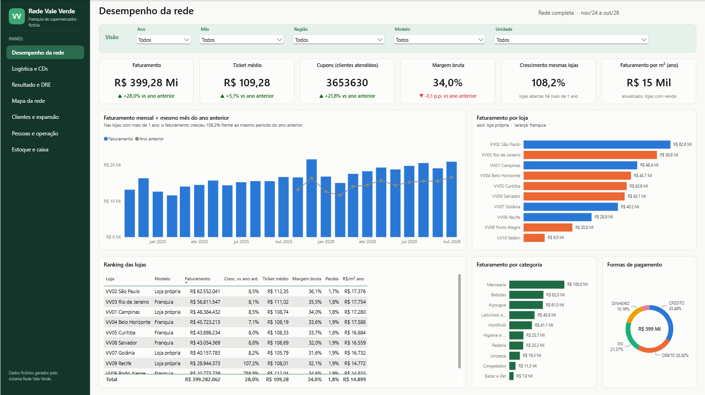
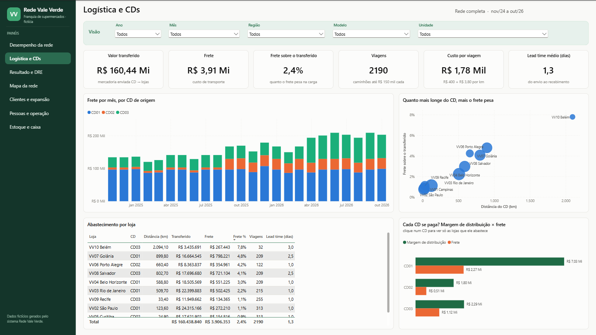
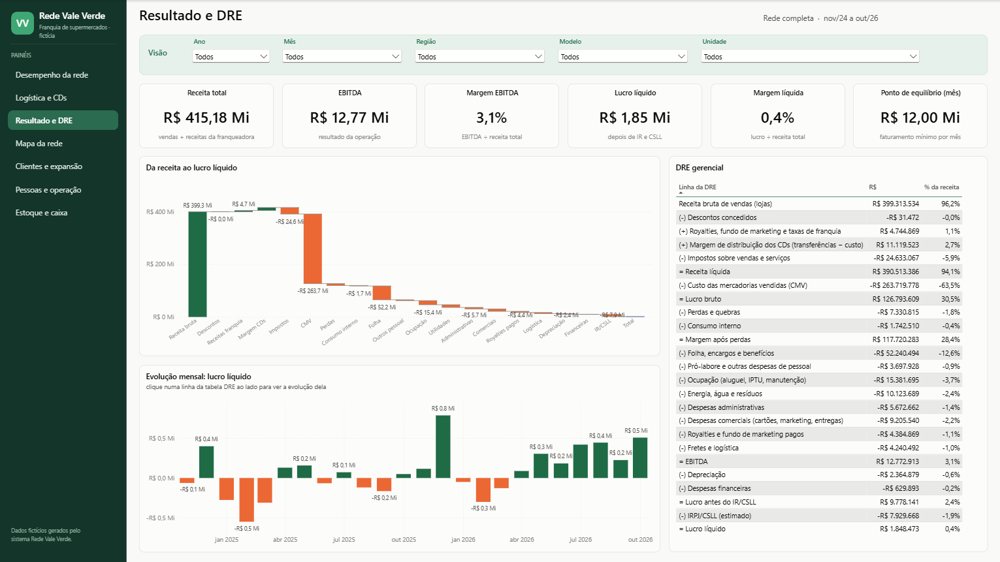
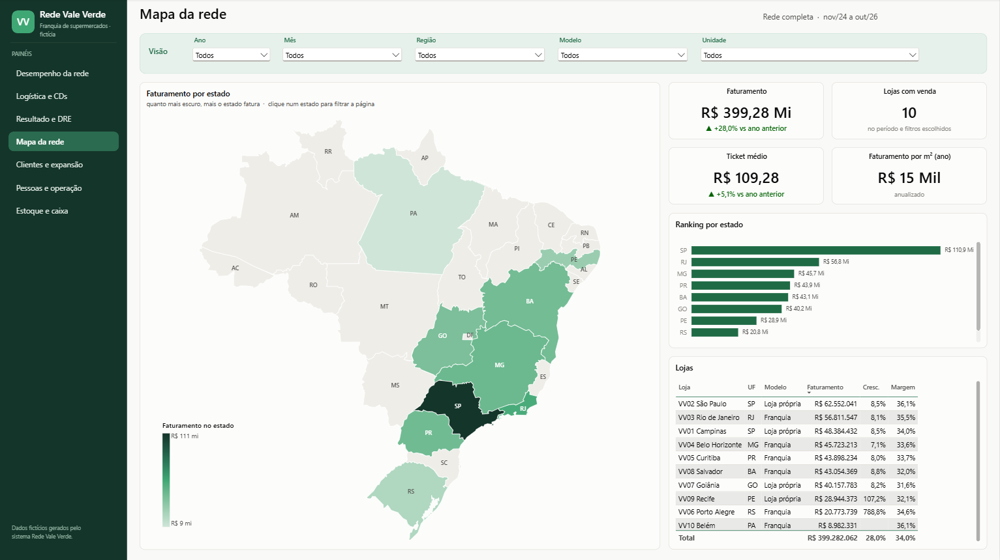
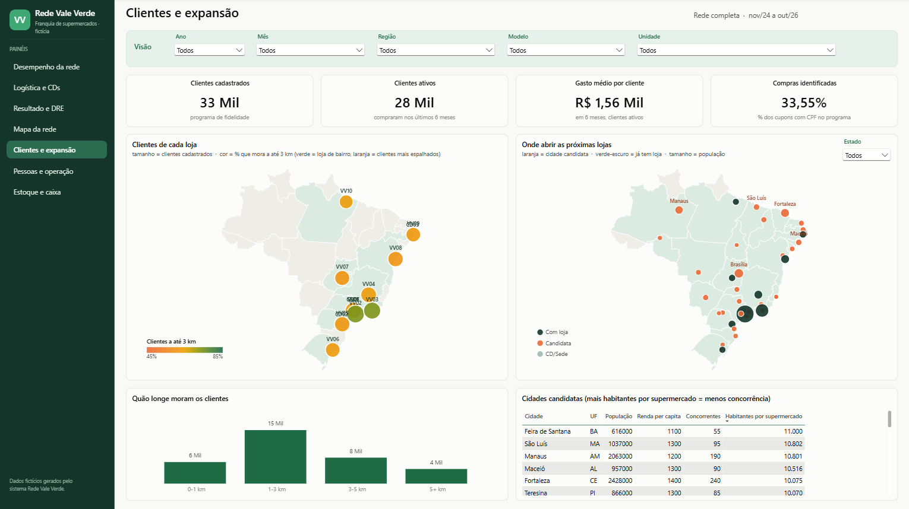
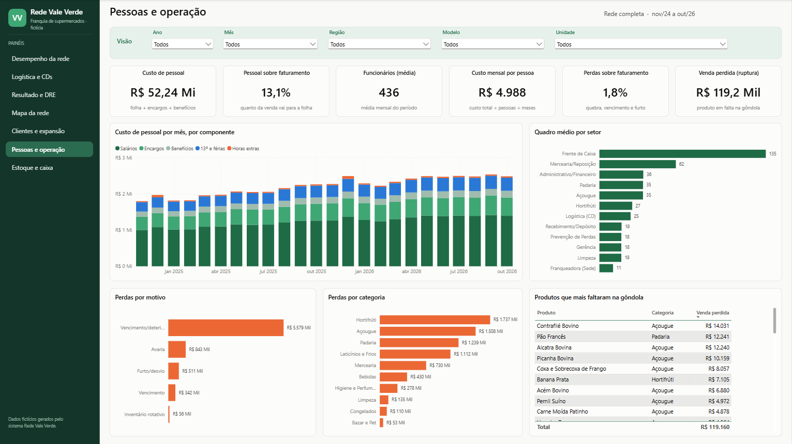
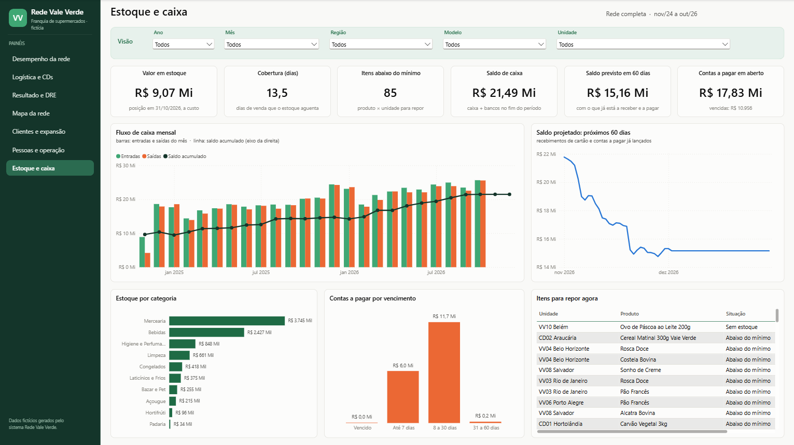

# Rede Vale Verde · BI de uma franquia de supermercados (fictícia)

**🇧🇷** Projeto de dados de ponta a ponta: um gerador em Python simula 24 meses de uma rede de supermercados
(franqueadora, 3 centros de distribuição e 10 lojas em 9 estados), um sistema web em Flask funciona como o ERP
da rede e um relatório Power BI de 7 páginas responde às perguntas de vendas, logística, DRE, caixa, clientes e pessoas.

**🇺🇸** End-to-end data project: a Python generator simulates 24 months of a supermarket chain (franchisor,
3 distribution centers and 10 stores in 9 Brazilian states), a Flask web app works as the chain's ERP, and a
7-page Power BI report answers questions on sales, logistics, P&L, cash, customers and people. All data is fictional.

**Portfólio / Portfolio:** https://marianacortezsottilo.github.io



| | |
|---|---|
|  |  |
|  |  |
|  |  |

## Destaques técnicos / Highlights

- **Modelo estrela** com 14 fatos e 6 dimensões (1,75 milhão de linhas), com o grão de cada fato documentado
  ([matriz de barramento](docs/img/modelo-pt.svg) · [bus matrix](docs/img/modelo-en.svg)).
- **DAX:** crescimento das mesmas lojas com períodos comparáveis, ano anterior, DRE em formato longo,
  saldo de caixa acumulado, cobertura de estoque, ponto de equilíbrio e textos dinâmicos.
- **Relação inativa + `USERELATIONSHIP`** para ver as transferências pelo CD de origem sem duplicar a dimensão.
- **Deneb (Vega-Lite):** mapa coroplético do Brasil clicável, com contornos do IBGE simplificados para 35 KB.
- **Projeto em formato PBIP** (TMDL + PBIR): o modelo, as medidas e os visuais ficam em texto legível e versionável.
- **Dicionário de dados** gerado por script ([DICIONARIO.md](powerbi/DICIONARIO.md)) e aplicado como descrição das colunas no Power BI.

## A rede

| Unidade | Cidade | Modelo | Abastecida por | Inauguração |
|---|---|---|---|---|
| SEDE · Vale Verde Franquias | Campinas/SP | Franqueadora | — | 2019 |
| CD01 · Sudeste/Centro-Oeste | Hortolândia/SP | Centro de distribuição | — | 2019 |
| CD02 · Sul | Araucária/PR | Centro de distribuição | — | 2022 |
| CD03 · Nordeste/Norte | Cabo de Santo Agostinho/PE | Centro de distribuição | — | 2022 |
| VV01 Campinas · VV02 São Paulo · VV07 Goiânia · VV09 Recife | | Lojas próprias | CD01 / CD03 | 2019–**mar/2025** |
| VV03 Rio · VV04 BH · VV05 Curitiba · VV08 Salvador · VV06 Porto Alegre · VV10 Belém | | Lojas franqueadas | CD01 / CD02 / CD03 | 2021–**abr/2026** |

Ordem de grandeza: ~R$ 224 mi de faturamento nos últimos 12 meses, ~460 funcionários ativos, 237 SKUs e 37 fornecedores
(7 nacionais e 30 regionais). Três lojas foram inauguradas durante o período e têm curva de maturação.

### Como a rede funciona
- **Mercearia, bebidas, limpeza, higiene, congelados e bazar** são comprados de forma centralizada pelos CDs
  junto a fornecedores nacionais, com 6% de desconto, e **transferidos** às lojas a custo + 1%. O frete por
  viagem é R$ 400 + R$ 3,80/km. Lojas distantes do CD (Belém, Goiânia) pagam mais logística.
- **Perecíveis** (hortifrúti, açougue, padaria, laticínios e frios) vão direto do fornecedor **regional** para a
  loja, com custo regional diferente (o Norte é mais caro).
- **Franqueados** pagam royalties (1,5%) e fundo de marketing (0,5%) sobre a receita bruta, pagam as
  transferências do CD em 21 dias e pagaram uma taxa inicial de R$ 180 mil. Nas lojas próprias, a
  transferência é intercompany e não gera título.
- **Encarte nacional** semanal; cada loja aplica seu fator de preço regional.
- **Sazonalidade regional:** festas juninas no Nordeste, inverno mais forte no Sul e Círio de Nazaré em Belém.

## Como rodar

```bash
pip install -r requirements.txt
python run.py      # na 1ª vez gera o banco (~1 a 2 min, ~500 MB) e abre em http://127.0.0.1:5000
```

Opções do gerador (`python gerador/gerar_dados.py --help`):
- `--seed 7`: outra "realidade" com a mesma lógica;
- `--meses-cupons 6` e `--meses-itens 2` (padrão): definem quantos meses de cupons e itens individuais ficam
  gravados. Os **24 meses completos** estão sempre nos resumos diários (`resumo_vendas_diario`,
  `resumo_cupons_diario`), que alimentam DRE, projeções e mapas. Aumentar esses valores deixa o banco bem maior.

**Internet:** mapas (Leaflet + OpenStreetMap/CARTO), contornos dos estados (API de malhas do IBGE) e gráficos
(Chart.js) são carregados da internet. Para ter os gráficos offline, salve
`https://cdn.jsdelivr.net/npm/chart.js@4.4.1/dist/chart.umd.min.js` em `app/static/chart.umd.min.js`.

## Seletor de visão

No topo de todas as telas: **Rede (todas as lojas)**, **Lojas próprias**, **Lojas franqueadas**,
**Franqueadora (próprias + CDs + sede)**, **Todas as unidades** ou **uma unidade específica**. Todas as
consultas, a DRE, o fluxo de caixa, o RH e as projeções respeitam a seleção. Na DRE da rede, royalties e
margem dos CDs aparecem como receita da franqueadora e como custo das lojas, com efeito líquido zero. No fluxo
de caixa, os pagamentos entre unidades da própria seleção são eliminados.

## Módulos

| Área | Telas |
|---|---|
| **Rede e mapas** | Comparativo da rede (mapa de bolhas por loja, estados preenchidos por faturamento, rotas CD → loja, ranking e crescimento same-store) · Clientes e área de influência (clientes geolocalizados, mapa de calor, anéis de 1/3/5 km, concorrentes, raio de 80% do valor) · Logística (rotas, frete/valor, fornecedores nacionais e regionais, simulador de frete) · Expansão (28 cidades candidatas, índice de atratividade com pesos ajustáveis, faturamento potencial, payback) · Franqueadora e franqueados · Ficha de cada unidade |
| **Comercial** | Vendas, curva ABC, promoções (elasticidade), cupons, PDV |
| **Suprimentos** | Pedidos (CD → nacional, loja → regional), transferências CD → loja, sugestão de compra (gera pedidos e transferências), estoque por unidade com kardex, perdas e rupturas, consumo interno |
| **Financeiro** | DRE gerencial, fluxo de caixa, contas a pagar, despesas fixas × variáveis, projeções com simulador de cenários |
| **Pessoas** | Funcionários por unidade, escala 6×1, folha com encargos e provisões, indicadores (turnover, absenteísmo, pessoal ÷ faturamento) |
| **Dados** | Produtos, fornecedores, clientes (RFM), Consulta SQL (somente leitura, com exemplos), dicionário de dados |

Quase todas as telas têm o botão **⬇ Excel**.

## Projeções
Modelo em painel com todas as lojas: `log(faturamento/dia) = efeito da loja + tendência + sazonalidade
mensal + log(curva de maturação)`. As lojas novas seguem crescendo pela curva de maturação, e a projeção
de uma seleção é a soma das lojas. O sistema mostra o erro dentro da amostra (MAPE) e um backtest fora da
amostra (6 meses), e o simulador calcula a DRE projetada com ponto de equilíbrio.

## Simplificações (modelo didático)
- Renda per capita e número de concorrentes por cidade são estimativas ilustrativas; a população é aproximada
  (Censo 2022). Para análises reais, troque pelos dados do IBGE na tabela `cidades`.
- Tributos com alíquotas efetivas únicas. IR/CSLL é estimado sobre o lucro positivo de cada entidade:
  cada franqueado é uma empresa, e a franqueadora consolida as lojas próprias, os CDs e a sede.
- INSS/IRRF com tabelas aproximadas. Frete com custo fixo + km.
- Distância rodoviária = linha reta × 1,25.

## Power BI

O relatório está em `Vale_Verde_Dashboard/` no formato **PBIP** (abra o arquivo `.pbip` no Power BI Desktop).

| Página | Pergunta que responde |
|---|---|
| Desempenho da rede | Quanto a rede cresce sem contar as inaugurações? Quais lojas puxam o resultado? |
| Logística e CDs | Quanto do valor enviado fica no frete? Cada CD se paga? |
| Resultado e DRE | Da receita ao lucro líquido, por unidade e por mês. |
| Mapa da rede | Onde está o faturamento, estado a estado. |
| Clientes e expansão | De onde vêm os clientes e onde abrir as próximas lojas. |
| Pessoas e operação | Folha, perdas e produtos que faltaram na gôndola. |
| Estoque e caixa | Fluxo de caixa, saldo projetado em 60 dias, contas a pagar e reposição. |

**Para abrir com dados:**
1. Gere o banco (`python run.py`, na primeira vez) e exporte os CSVs: `python powerbi/exportar_powerbi.py`
   (cria `powerbi/dados/` com 20 arquivos).
2. As consultas do Power Query leem os CSVs pelo caminho completo da pasta `powerbi/dados`. Em outro computador,
   troque esse caminho nos arquivos `Vale_Verde_Dashboard/*.SemanticModel/definition/tables/*.tmdl`
   (Localizar e substituir) ou no Power Query.
3. Abra o `.pbip` e clique em **Atualizar**.

Arquivos de apoio em `powerbi/`: `medidas.dax`, `DICIONARIO.md`, `dicionario.py` (gera o dicionário a partir do modelo)
e `ROTEIRO.md`.

## Estrutura
```
app/                  Flask (rotas_*.py, relatorios.py, folha.py), templates e estáticos (vv.js, vv_mapa.js)
db/schema.sql         modelo de dados (33 tabelas)
gerador/              catalogo.py (produtos, cargos), rede.py (cidades, unidades, franqueados), gerar_dados.py
consultas_exemplo.sql consultas prontas (rede, mapas, franquia, logística, expansão)
run.py                inicia o sistema
powerbi/              exportação para CSV, medidas DAX e dicionário de dados
Vale_Verde_Dashboard/ relatório Power BI em formato PBIP (modelo TMDL + relatório PBIR)
docs/img/             prints dos painéis
```

## Ideias de exercícios
1. Vale abrir um **CD Norte** em Belém? Compare o frete de VV10 com o custo de um CD pequeno.
2. Mapa coroplético de **faturamento por habitante** por estado: onde a rede está sub-representada?
3. **Same-store sales** por região: o crescimento vem de lojas novas ou das existentes?
4. Defina o **raio de influência** de cada loja (80% do valor) e cruze com a posição dos concorrentes.
5. Calibre o modelo de expansão com outras variáveis (população no raio, concorrentes) e compare os rankings.
6. Franquia × própria: qual teria sido o resultado da franqueadora se VV03 (Rio) fosse própria?

## Licença
Código sob a licença MIT (veja `LICENSE`). Os dados são fictícios e gerados pelo próprio projeto.
